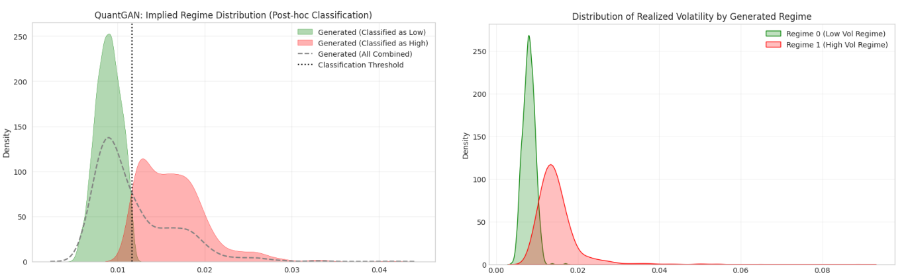
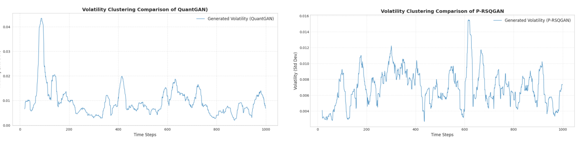
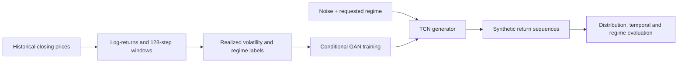

# Synthetic Financial Time Series Generation with GANs

**A comparative study of four GAN baselines and a regime-controllable extension, P-RSQGAN.**

Financial returns are difficult to simulate convincingly: their distributions are heavy-tailed, volatility clusters over time, and market conditions change. This project examines how well generative adversarial networks reproduce those properties and investigates whether the volatility regime can be **selected at generation time** rather than only identified afterward.

We compare **LSTM-GAN, TimeGAN, WGAN-GP, and QuantGAN** under a common evaluation framework, then introduce **Projection Regime-Specific QuantGAN (P-RSQGAN)**, which combines regime-conditioned generation, a projection-based critic, and WGAN-GP training.

> **Project:** Final Year Project (BSc Honours in Computer Science and Technology), Beijing Normal–Hong Kong Baptist University, December 2025  
> **Authors:** Yixin Xia and Manxi Tao  
> **Thesis:** [Synthetic Financial Time Series Generation with GANs: A Comparative Study and the Proposed P-RSQGAN](Synthetic%20Financial%20Time%20Series%20Generation%20with%20GANs.pdf)

## Highlights

- **Five architectures:** Four established baselines plus our proposed conditional P-RSQGAN.
- **Two financial series:** A NASDAQ index series (`NDX`) and spot gold (`AU9999`), evaluated as daily log-returns.
- **Multi-view evaluation:** Distributional fidelity, tail behavior, temporal dependence, volatility clustering, and price-path realism.
- **Controllable volatility:** P-RSQGAN generates sequences conditioned on a requested low- or high-volatility regime.
- **Reported regime adherence:** **88.20%** overall consistency in the thesis experiment; high-volatility recall is **76.5%**, revealing remaining conditional leakage.

## Key findings

### 1. Baselines reproduce some stylized facts, but do not offer regime control

The baseline comparison finds that the models can reproduce central return-distribution features and near-zero linear autocorrelation to varying degrees. **QuantGAN and WGAN-GP show stronger tail fidelity** than the recurrent baselines in the reported visual comparisons. However, all four baselines are *unconditional*: volatility states may emerge, but a user cannot directly request a particular state when sampling.

### 2. P-RSQGAN enables conditional generation

P-RSQGAN uses realized volatility to label training windows and conditions the generator on a target regime. A **projection-based critic** explicitly scores compatibility between the generated sequence and that label. Training uses a Wasserstein objective with a gradient penalty to support stability.



*Figure: Volatility distributions reproduced from the thesis (Figure 14). QuantGAN's low/high regimes are assigned **after** generation; P-RSQGAN's regime labels are specified **before** generation.*

### 3. The conditional effect is measurable, but imperfect

The thesis reports the following results for the conditional-generation evaluation:

| Metric | Low-volatility regime (0) | High-volatility regime (1) |
| --- | ---: | ---: |
| Mean realized volatility | 0.007969 | 0.014876 |
| Standard deviation of realized volatility | 0.001448 | 0.005903 |
| Regime recall | 99.9% (999/1,000) | 76.5% (765/1,000) |

**Overall regime-consistency accuracy: 88.20%** (1,764 of 2,000 samples). The stronger low-volatility adherence and weaker high-volatility adherence are important limitations, not just a single aggregate score.



*Figure: Rolling-volatility comparison reproduced from the thesis (Figure 12). QuantGAN shows smoother, more naturally evolving volatility clusters in the illustrated paths; P-RSQGAN makes regime changes more distinct. Controllability therefore does not imply superiority on every realism dimension.*

## Models

| Model | Architecture / training | Role |
| --- | --- | --- |
| **LSTM-GAN** | LSTM generator and discriminator; standard adversarial objective | Sequential baseline |
| **TimeGAN** | Embedding/recovery networks, generator, supervisor, and discriminator; supervised temporal loss | Temporal-structure baseline |
| **WGAN-GP** | LSTM-based generator and critic; Wasserstein objective with gradient penalty | Stability-oriented baseline |
| **QuantGAN** | Temporal Convolutional Network (TCN) generator and critic, trained with WGAN-GP | Finance-oriented temporal baseline |
| **P-RSQGAN** | Conditional TCN generator + projection critic + WGAN-GP | **Proposed model:** regime-controlled sampling |

### P-RSQGAN in brief

1. Compute daily **log-returns** from closing prices and construct overlapping **128-step windows**.
2. Compute each window's realized volatility and assign a binary regime label using a median split (**0 = low**, **1 = high**).
3. Concatenate the regime embedding to the generator's noise channels, then process the sequence with a causal, dilated TCN.
4. Score real and generated sequences using a TCN critic with an explicit **feature–regime embedding projection**.
5. Optimize using a conditional **WGAN-GP** objective; generate new sequences by supplying the requested regime label.



*The diagram is a conceptual workflow, not an executable dependency graph.*

## Data and experimental protocol

| Item | NASDAQ index (`NDX`) | Spot gold (`AU9999`) |
| --- | --- | --- |
| Source in thesis | Yahoo Finance | RESSET Financial Research Database |
| Observation | Daily closing price | Daily closing price |
| Study period | 2014-01-02 to 2024-12-30 | 2015-09-30 to 2025-09-30 |
| Approx. observations | ~2,750 | ~2,500 |
| Input representation | Daily log-returns | Daily log-returns |
| Window length | 128 | 128 |
| Dataset split | Time-ordered | Time-ordered |

The thesis describes a shared experimental protocol, including fixed window lengths, training-only normalization statistics, held-out evaluation, and fixed random seeds where applicable. Individual notebooks retain their own training settings and preprocessing code; inspect them when comparing exact runs.

**Raw market data are not included in this repository.** Access to the original gold source may require separate authorization. The two datasets also use different CSV schemas in the notebooks:

- **NASDAQ:** typically `ndx_data.csv`, with `Date` and `Close` columns.
- **Gold:** typically `Gold.csv`, with `TrdDt` (trading date) and `ClPr` (closing price) columns.

> **Dataset naming note:** The thesis labels the equity series `NDX`. When replacing or redownloading it, verify the exact instrument/ticker against the original data and do not silently substitute a different NASDAQ index.

## Repository structure

The repository currently contains **model-specific Jupyter notebooks**, not a packaged training application:

```text
Synthetic-Financial-Time-Series-Generation-with-GANs/
├── GAN_ndx.ipynb                  # LSTM-GAN / NASDAQ
├── GAN_gold.ipynb                 # LSTM-GAN / gold
├── TimeGAN_ndx.ipynb              # TimeGAN / NASDAQ
├── TimeGAN_gold.ipynb             # TimeGAN / gold
├── WGAN_ndx.ipynb                 # WGAN-GP / NASDAQ
├── WGAN_gold.ipynb                # WGAN-GP / gold
├── QuantGAN_ndx.ipynb             # QuantGAN / NASDAQ
├── QuantGAN_gold.ipynb            # QuantGAN / gold
├── P-RSQGAN_ndx.ipynb             # P-RSQGAN / NASDAQ
├── P-RSQGAN_gold.ipynb            # P-RSQGAN / gold
├── Synthetic Financial Time Series Generation with GANs.pdf
├── assets/                        # Selected figures from the thesis
│   ├── regime_volatility_distributions.png
│   ├── rolling_volatility_comparison.png
│   └── qq_plot_comparison.png
└── README.md
```

*The `assets/` folder is distributed with this README draft and must be added to the repository alongside it for the inline figures to display on GitHub.*

## Getting started

### 1. Create a Python environment

```bash
git clone https://github.com/Chloe-Xia/Synthetic-Financial-Time-Series-Generation-with-GANs.git
cd Synthetic-Financial-Time-Series-Generation-with-GANs

python3 -m venv .venv
source .venv/bin/activate        # Windows PowerShell: .venv\Scripts\Activate.ps1
python -m pip install --upgrade pip
python -m pip install jupyterlab torch numpy pandas scipy scikit-learn matplotlib seaborn statsmodels
jupyter lab
```

These packages cover common dependencies visible in the reviewed notebooks. The repository **does not currently provide** a pinned `requirements.txt`, environment lockfile, or verified one-command installation. You may need additional packages depending on the notebook and your data-acquisition workflow. CUDA is optional for opening notebooks, but training can be computationally expensive without a GPU.

### 2. Prepare the data

Obtain the corresponding daily price data, preserve the column names expected by the notebook, and edit the input-path variable near the top of the notebook.

Several notebooks currently contain machine-specific paths, for example:

```python
# Example only — replace the existing value in the chosen notebook
DATA_PATH = "data/Gold.csv"
# or, in notebooks using DATA_FILE:
DATA_FILE = "data/ndx_data.csv"
```

The original code uses paths such as `/root/autodl-tmp/Gold.csv` and `/root/autodl-tmp/ndx_data.csv`, which will not exist on most local machines. **Changing the README alone does not update these hard-coded paths.** The CSV contents and any preprocessing assumptions should be checked before execution.

### 3. Run one experiment notebook

Open the notebook for the chosen **model + dataset** and run its cells in order. For example:

- [`QuantGAN_gold.ipynb`](QuantGAN_gold.ipynb) — unconditional TCN baseline on gold.
- [`P-RSQGAN_gold.ipynb`](P-RSQGAN_gold.ipynb) — proposed conditional model on gold.
- [`P-RSQGAN_ndx.ipynb`](P-RSQGAN_ndx.ipynb) — proposed model on the NASDAQ series.

The notebooks contain model definitions, training loops, sampling, and visual diagnostics. Some training settings run for **thousands of epochs**; consider a short smoke test before attempting thesis-scale reproduction. The saved outputs in the repository are not a substitute for re-running the experiments.

### 4. Interpret the outputs

Compare generated returns with the real-data holdout using several complementary views:

- **Distribution:** density/KDE plots and Q–Q plots, including tails.
- **Temporal structure:** return autocorrelation, autocorrelation of absolute returns, and rolling realized volatility.
- **Path-wise behavior:** synthetic price paths and fan charts based on compounded returns.
- **Conditional control:** regime-specific volatility distributions, confusion matrix, accuracy, precision, recall, and F1.

Avoid using a single attractive plot or summary metric as evidence of full realism.

## Limitations and future work

- **Binary regimes:** Low/high volatility is based on a window-volatility median split; market regimes are more complex than two labels.
- **Asymmetric control:** High-volatility generation leaks into the low-volatility class more often than the reverse.
- **Limited cross-market validation:** The thesis focuses on two assets and fixed-length windows, so generalization to different frequencies, markets, or horizons remains untested.
- **No downstream financial-utility benchmark:** The study does not demonstrate improvements in VaR forecasting, stress-testing performance, or trading strategies.
- **Reproduction friction:** Hard-coded local data paths, unbundled datasets, and unpinned environments make exact reproduction environment-dependent.

Potential extensions include multi-regime conditioning, improved conditional losses, broader market benchmarks, stronger tail-risk diagnostics, and application-level validation.

## Reference

**Yixin Xia and Manxi Tao.** *Synthetic Financial Time Series Generation with GANs: A Comparative Study and the Proposed P-RSQGAN.* Bachelor of Science (Honours) Final Year Project, Beijing Normal–Hong Kong Baptist University, December 2025. [Read the thesis](Synthetic%20Financial%20Time%20Series%20Generation%20with%20GANs.pdf).

The figures shown above are cropped from the authors' thesis (Figures 12 and 14); they depict reported experimental results, **not new evaluations run to prepare this README**.
